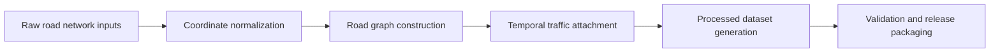
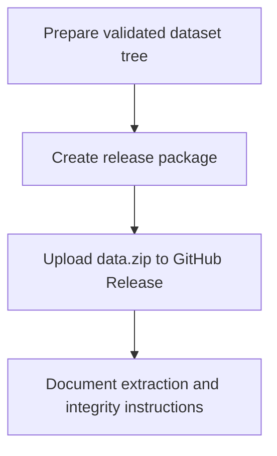

<div align="center">
  

  <h1>Chronos-SG-2026 Dataset</h1>
  <p><strong>Dataset artifact for secure time-window-aware semi-constrained navigation experiments.</strong></p>

  <p>
    <a href="https://github.com/NavTest1/Chronos/releases/tag/v1.0.0"></a>
    
    
  </p>
</div>

---

## Overview

This repository contains the **dataset construction and packaging artifact** for the Chronos project.

It is organized around the Chronos-SG-2026 dataset, which includes:

- the source road-network inputs,
- preprocessing and validation code,
- packaging utilities for release creation,
- metadata and schema documentation, and
- helper scripts for inventory and integrity checking.

> [!IMPORTANT]
> The public dataset package is distributed via the official GitHub release page:  
> **https://github.com/NavTest1/Chronos/releases/tag/v1.0.0**

---

## Table of Contents

- [Highlights](#highlights)
- [Repository Layout](#repository-layout)
- [Dataset Methodology](#dataset-methodology)
- [Quick Start](#quick-start)
- [Release Packaging](#release-packaging)
- [Files Included in the Public Dataset](#files-included-in-the-public-dataset)
- [Citation](#citation)

---

## Highlights

<table>
<tr>
<td width="50%" valign="top">

### 🗺️ Included in this repository
- Dataset construction utilities
- Validation helpers
- Inventory scripts
- Release packaging helpers
- Documentation for methodology and schema

</td>
<td width="50%" valign="top">

### ✨ Presentation goals
- Clear GitHub landing page
- Release-oriented organization
- Public-facing methodology summary
- Easy linkage to the dataset release
- Minimal setup friction for artifact reviewers

</td>
</tr>
</table>

---

## Repository Layout

```text
Chronos-SG-2026-Dataset/
├── dataset/                    # Dataset build and packaging entry points
├── chronos/init/               # Dataset validation and coordinate handling
├── chronos/preprocess/         # Preprocessing utilities
├── tools/                      # Inventory helpers
├── docs/                       # Methodology and schema notes
├── requirements.txt
└── README.md
```

---

## Dataset Methodology



The dataset artifact is designed to support the Chronos experimental workflow in a reproducible way. At a high level, the pipeline:

1. organizes raw road-network inputs,
2. normalizes spatial coordinates,
3. constructs processed road-graph artifacts,
4. attaches temporal traffic information,
5. prepares benchmark query files, and
6. validates the resulting dataset before release packaging.

For more details, see:

- [`docs/METHODOLOGY.md`](docs/METHODOLOGY.md)
- [`docs/SCHEMA.md`](docs/SCHEMA.md)

---

## Quick Start

### Install dependencies

```bash
python -m venv .venv
. .venv/bin/activate        # Linux / macOS
# .venv\Scripts\activate    # Windows PowerShell
pip install -r requirements.txt
```

### Inspect repository contents

```bash
python -m tools.inventory
```

### Run dataset build entry

```bash
python -m dataset.build --help
```

### Validate dataset structure

```bash
python -m chronos.init.validate_dataset --help
```

---

## Release Packaging

The public release package is published at:

**https://github.com/NavTest1/Chronos/releases/tag/v1.0.0**

Typical packaging workflow:



Create a release package locally:

```bash
python -m dataset.package_release --help
```

List the artifact inventory:

```bash
powershell -ExecutionPolicy Bypass -File run_inventory.ps1
```

---

## Files Included in the Public Dataset

The public dataset release is expected to restore a structure like:

```text
data/
└── singapore/
    ├── raw/
    ├── processed/
    ├── queries/
    ├── traffic/
    └── README.md
```

This structure is the expected input for the experiment repository.

---

## Citation

If you use the dataset in academic work, please cite the corresponding Chronos paper.

```bibtex
@misc{chronossg2026,
  title={Chronos-SG-2026 Dataset},
  author={Anonymous},
  year={2026},
  note={Dataset artifact for Chronos experiments}
}
```

---

<div align="center">
  <sub>Designed for clean public release and reproducible dataset distribution.</sub>
</div>
